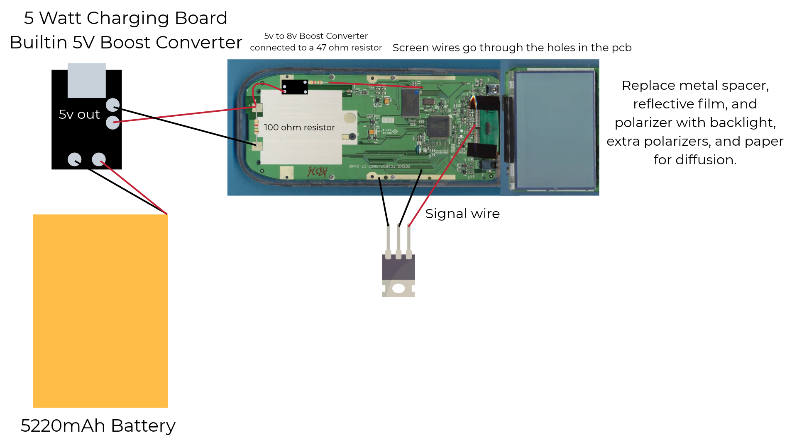
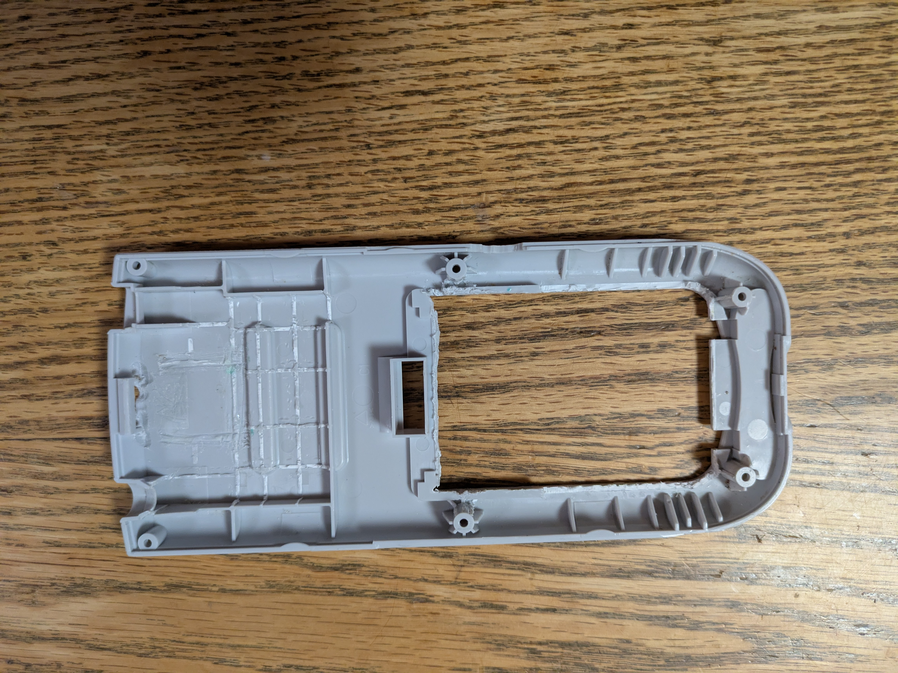

# Ti-84-backlight
A diagram showing how to make a Ti-84 with a backlit screen and rechargeable battery.

The Battery being used is pulled out of a Nintendo Switch 2. 
The guide I followed for getting the backlight working can be found at [Handheld Legend's guide](https://handheldlegend.com/en-ch/blogs/news/backlighting-your-ti-84-plus-using-a-hand-held-legend-backlight). 
The signal wire for controlling the backlight can be found at the second to the left contact from the middle of the screen cable. This contact should provide around 3 volts and is hooked up to a mosfet. 
The items I bought from amazon can be found here: 
* [Charging Board](https://a.co/d/0eiYJqfe)
* [Boost Converter](https://a.co/d/0gWq0Xsg)
* [Mosfet](https://a.co/d/0cMM2mvF)
* [BMS Board](https://a.co/d/03vc9Rpq) 
The items I bought from Handheld Legend can be found here:
* [Sega Game Gear Backlight](https://handheldlegend.com/collections/sega-game-gear-displays/products/game-gear-backlight-replacement)
* [Polarizer Film](https://handheldlegend.com/products/polarization-film?_pos=1&_sid=d9096d248&_ss=r&variant=39266442150022) 
The paper used for light diffusion should be thin origami paper. Dark colors can make the screen unusable unless you have enough light coming from the backlight.  
Major shell trimming is required for the battery and charging board to fit. 
I recommend using a Dremel to make a hole for the usb port. For the rest of the shell i used flush cutter to cut out the rest. When creating the hole also cut out a bit of plastic in front of the board so the cable can reach the port. 
 
↑ This is a picture showing the cut outs made from a top down view. 
 
↑ This is a picture showing the cut out for the usb port. 
